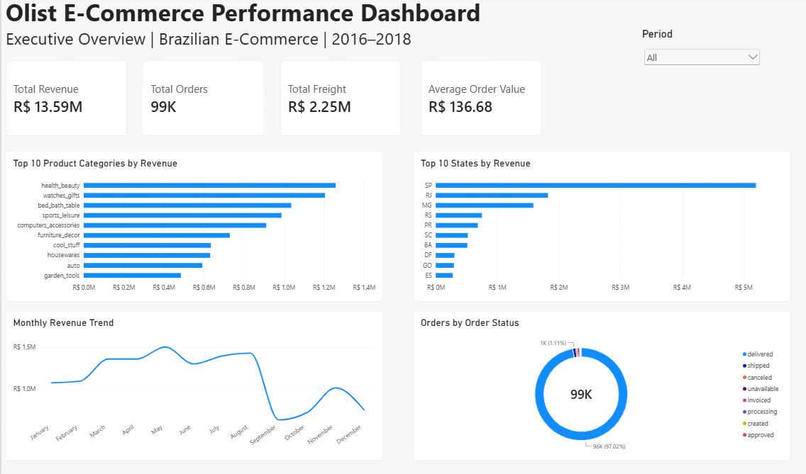
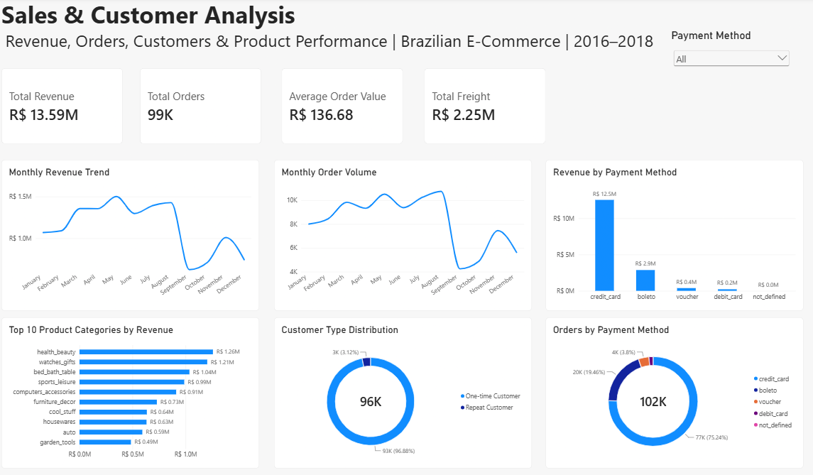
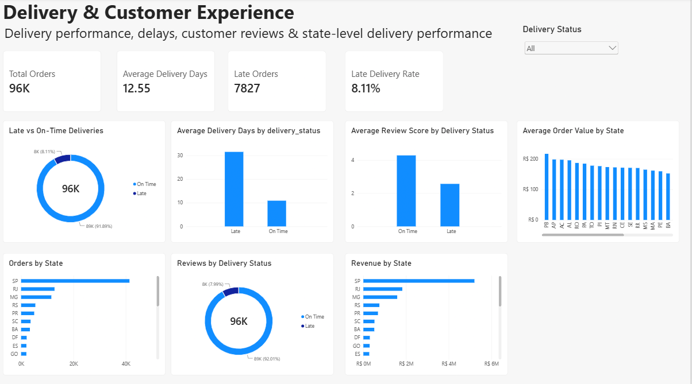
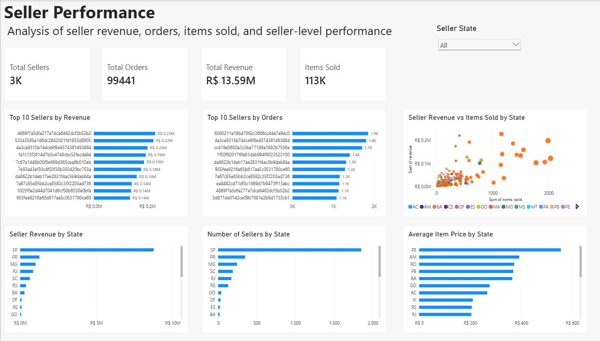

# Brazilian E-Commerce Data Analysis | Olist

## Project Overview

This project analyzes the Brazilian E-Commerce Public Dataset by Olist to evaluate sales performance, customer behavior, delivery efficiency, customer satisfaction, and seller performance.

Using PostgreSQL for data storage and SQL analysis and Power BI for interactive visualization, this project transforms raw e-commerce data into business insights and actionable recommendations.

## Business Objectives

* Evaluate overall revenue, order volume, freight costs, and average order value.
* Identify top-performing product categories and geographic markets.
* Analyze customer purchasing behavior and repeat-customer activity.
* Evaluate payment method usage and payment value.
* Investigate delivery performance, delays, and customer review scores.
* Compare seller performance by revenue, order volume, and items sold.

## Dataset

This project uses the **Brazilian E-Commerce Public Dataset by Olist**, available on Kaggle.

The dataset contains information about orders, customers, order items, payments, reviews, products, sellers, geolocation, and product category translations.

**Dataset source:** [Brazilian E-Commerce Public Dataset by Olist — Kaggle](https://www.kaggle.com/datasets/olistbr/brazilian-ecommerce)

### Dataset availability

The original CSV files are not all included in this repository because `olist_geolocation_dataset.csv` exceeds GitHub's browser upload limit.

To reproduce the analysis, download the original dataset from Kaggle and place the CSV files in your local project folder. The geolocation file is needed for analyses that depend on geographic coordinates or the original geolocation data.

Other dataset files may be included in this repository where file size permits.

### Main dataset tables

| Dataset                                 | Description                                                            |
| --------------------------------------- | ---------------------------------------------------------------------- |
| `olist_customers_dataset.csv`           | Customer IDs, customer unique IDs, ZIP codes, cities, and states       |
| `olist_geolocation_dataset.csv`         | ZIP code prefixes and geographic coordinates                           |
| `olist_order_items_dataset.csv`         | Products sold within each order, seller IDs, prices, and freight       |
| `olist_order_payments_dataset.csv`      | Payment methods, installments, and payment values                      |
| `olist_orders_dataset.csv`              | Order status and purchase, approval, shipping, and delivery timestamps |
| `olist_order_reviews_dataset.csv`       | Customer review scores and review information                          |
| `olist_products_dataset.csv`            | Product IDs, categories, and product dimensions                        |
| `olist_sellers_dataset.csv`             | Seller IDs and location information                                    |
| `product_category_name_translation.csv` | Portuguese-to-English product category translations                    |

## Tools and Technologies

* **PostgreSQL** — relational database and data analysis
* **pgAdmin** — database administration and SQL query execution
* **SQL** — data validation, joins, aggregations, business metrics, and analytical views
* **Power BI Desktop** — interactive dashboards and KPI reporting
* **DAX** — calculated measures and report calculations
* **GitHub** — project documentation and portfolio publishing

## Project Workflow

1. Imported the Olist CSV datasets into PostgreSQL.
2. Validated table row counts, key relationships, and data consistency.
3. Investigated order statuses, revenue, freight, payment methods, customer behavior, delivery performance, and reviews.
4. Created SQL views to prepare data for dashboard reporting.
5. Connected Power BI to PostgreSQL and developed four interactive dashboard pages.
6. Documented the methodology, metrics, insights, and recommendations.

## Data Validation and Preparation

Data preparation and validation included:

* Checking imported table row counts.
* Reviewing primary identifiers and relationships between tables.
* Checking for orphaned records in selected relationships.
* Reviewing order status distributions and purchase dates.
* Investigating duplicate review identifiers before finalizing the review table.
* Creating analytical views for consistent reporting.
* Reviewing differences in metric totals caused by table joins and analysis scope.

### Selected table row counts

| Table          |      Rows |
| -------------- | --------: |
| Customers      |    99,441 |
| Geolocation    | 1,000,163 |
| Order items    |   112,650 |
| Order payments |   112,650 |
| Orders         |    99,441 |
| Order reviews  |    99,224 |
| Products       |    32,951 |
| Sellers        |     3,095 |

The review row count reflects the imported and prepared table used in this analysis. Counts and metrics may vary across views when different joins or analysis scopes are used.

## SQL Analysis

SQL was used to create analytical views for Power BI and to examine the following areas:

* Overall business KPIs
* Monthly sales and order trends
* Product category revenue
* State-level sales performance
* Customer purchasing behavior
* Payment method performance
* Delivery duration and late deliveries
* Customer review performance
* Seller revenue and order performance

### Main analytical views

The project includes views such as:

* `vw_overall_kpis`
* `vw_monthly_sales`
* `vw_total_orders`
* `vw_payment_performance`

Additional views support product category, customer, delivery, geographic, and seller analysis.

SQL scripts are provided in the `sql/` folder where available.

## Power BI Dashboards

The Power BI report contains four pages designed to answer different business questions.

### 1. Executive Overview

Provides a high-level summary of business performance.

**Key metrics**

* Total product revenue: **R$13.59 million**
* Total orders: **99,441**
* Total freight: **R$2.25 million**
* Average order value: **R$136.68**

**Visualizations**

* Monthly revenue trend
* Top 10 product categories by revenue
* Top 10 states by revenue
* Orders by order status
* Reporting-period slicer



### 2. Sales & Customer Analysis

Explores sales trends, customer purchasing patterns, product categories, and payment performance.

**Key findings**

* One-time customers account for approximately **96.88%** of customers in the customer classification used for this analysis.
* Repeat customers account for approximately **3.12%**.
* Health and beauty is a leading product category, generating approximately **R$1.26 million** in product revenue.
* Credit cards represent the largest share of recorded payment value.

**Visualizations**

* Monthly revenue trend
* Monthly order volume
* Top 10 product categories by revenue
* Customer type distribution
* Revenue by payment method
* Orders by payment method
* Payment-method slicer



**Payment method note:** Orders may use multiple payment methods. Consequently, the number of orders counted within each payment method can overlap, and adding the category counts does not produce the number of unique orders.

### 3. Delivery & Customer Experience

Examines delivery performance, late deliveries, customer review scores, and geographic differences.

**Key metrics**

* Average delivery time: approximately **12.55 days**
* Late delivery rate: approximately **8.11%**
* Late orders: approximately **7,827** in the delivery KPI view

**Key findings**

* Late deliveries are associated with lower average review scores in the analyzed data.
* The average review score is approximately **2.57** for late deliveries and **4.29** for on-time deliveries in the review analysis.
* Some states have substantially higher late-delivery rates than others.

**Visualizations**

* Late versus on-time deliveries
* Average delivery days by status
* Average review score by delivery status
* Reviews by delivery status
* Revenue by state
* Average order value by state
* Orders by state



These comparisons identify associations in the dataset; they do not establish that delivery delays alone caused lower review scores. Delivery metrics can also differ across views because of their underlying data scope.

### 4. Seller Performance

Compares seller revenue, order activity, items sold, and geographic distribution.

**Key metrics**

* Total sellers: **3,095**
* Total orders: **99,441**
* Total product revenue: **R$13.59 million**
* Items sold: **112,650**

**Visualizations**

* Top 10 sellers by revenue
* Top 10 sellers by orders
* Seller revenue versus items sold by state
* Seller revenue by state
* Number of sellers by state
* Average item price by state

**Key finding**

The five highest-revenue sellers collectively generated approximately **R$1.04 million**, or **7.61%** of total product revenue, indicating that a relatively small group of sellers contributed a meaningful share of sales.



## Key Business Insights

### 1. Product revenue is concentrated in leading categories

A small group of product categories contributes substantially to overall product revenue.

**Business implication:** Prioritize inventory availability, category-level marketing, and performance monitoring for high-revenue categories.

### 2. Repeat purchasing represents an opportunity

Repeat customers represent a relatively small proportion of the customers classified in this analysis.

**Business implication:** Test customer retention initiatives such as post-purchase communication, loyalty incentives, and relevant product recommendations. Measure whether these initiatives improve repeat purchasing.

### 3. Delivery performance is associated with customer satisfaction

Late deliveries are associated with lower review scores in the analyzed data.

**Business implication:** Investigate fulfillment bottlenecks, monitor delivery estimates, and prioritize operational reviews in states with high late-delivery rates.

### 4. Payment methods serve different customer preferences

Credit cards account for the largest share of recorded payment value, with boleto and other payment methods also contributing.

**Business implication:** Monitor payment success, payment-method usage, and customer preferences when evaluating checkout performance.

### 5. Seller performance varies

Seller revenue and order volumes vary considerably.

**Business implication:** Track seller-level performance, investigate operational differences, and identify opportunities to support sellers with growth potential.

### 6. Geographic performance differs across states

Revenue, order volume, and delivery performance vary geographically.

**Business implication:** Use state-level analysis to prioritize logistics investigations, market planning, and service improvements.

## Recommendations

Based on the analysis, the following actions are recommended:

1. **Improve customer retention:** Develop targeted retention initiatives and track repeat purchase rate over time.
2. **Prioritize delivery reliability:** Investigate regions with high late-delivery rates and monitor delivery performance regularly.
3. **Support high-performing product categories:** Use category-level revenue and order trends to inform inventory and marketing decisions.
4. **Monitor seller performance:** Track revenue, order volume, and items sold to identify opportunities for seller support.
5. **Optimize checkout performance:** Monitor payment-method usage and payment values while accounting for orders that use multiple payment methods.
6. **Improve geographic planning:** Combine state-level sales and delivery metrics to guide further operational investigation.

These recommendations are proposed actions based on observed patterns, not experimentally verified outcomes.

## Metric Definitions and Notes

* **Product revenue:** Sum of product item prices, excluding freight.
* **Freight:** Sum of recorded freight charges for order items.
* **Average order value:** Defined in the relevant analytical view; the overall KPI is approximately R$136.68.
* **Total orders:** Counts distinct orders from the orders table where the KPI is sourced from `olist_orders`.
* **Orders by payment method:** Counts distinct orders within each payment method. An order can appear in more than one payment-method category.
* **Late delivery rate:** Calculated within the scope of the delivery analysis and its eligible orders.
* **Review metrics:** Calculated from the review records included in the relevant analysis.

Totals may differ across visuals when views use different joins, date fields, or eligible records. Payment-method category counts can overlap, and order-item-based analyses may not include orders without associated items.

## Repository Structure

```text
Olist-dataset/
├── sql/
│   └── analysis_queries.sql
├── powerbi/
│   └── Olist_Analysis.pbix
├── screenshots/
│   ├── 01-executive-overview.png
│   ├── 02-sales-customer-analysis.png
│   ├── 03-delivery-customer-experience.png
│   └── 04-seller-performance.png
└── README.md
```

The repository contain smaller CSV files. The large `olist_geolocation_dataset.csv` file is excluded because it exceeds GitHub's browser upload limit.

## How to Reproduce the Analysis

1. Download the [Brazilian E-Commerce Public Dataset by Olist from Kaggle](https://www.kaggle.com/datasets/olistbr/brazilian-ecommerce).
2. Extract the CSV files into a local project folder.
3. Create a PostgreSQL database.
4. Import the CSV files into PostgreSQL using the required table structures and column data types.
5. Run the SQL scripts in the `sql/` folder to create the analytical views and perform the analysis.
6. Open the Power BI report in Power BI Desktop.
7. Configure the PostgreSQL connection to match your local database settings.
8. Refresh the data and review the four dashboard pages.

Connection settings, local file paths, and import procedures may need to be adjusted for your environment.

## Limitations

* The analysis reflects the historical period represented in the dataset and does not describe current e-commerce performance.
* Observed relationships do not establish causation.
* Some metrics depend on the records and joins used by each analytical view.
* Payment-method order counts overlap when a single order uses multiple payment methods.
* The original geolocation CSV is not stored in this repository due to its size and must be downloaded separately for reproduction.

## Conclusion

This project demonstrates an end-to-end data analysis workflow, from data preparation and validation in PostgreSQL to SQL-based business analysis and interactive Power BI reporting.

It highlights how e-commerce data can be used to evaluate sales, customer behavior, delivery performance, customer satisfaction, and seller activity, and to develop practical recommendations for further investigation.

## Author

**Arista Kayirangwa Aimee**

Data Analyst Portfolio Project

Tools: PostgreSQL | SQL | Power BI | DAX
